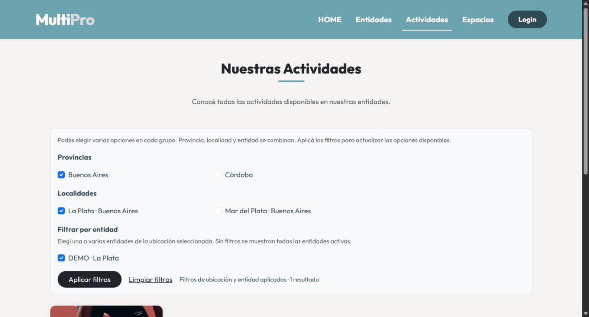
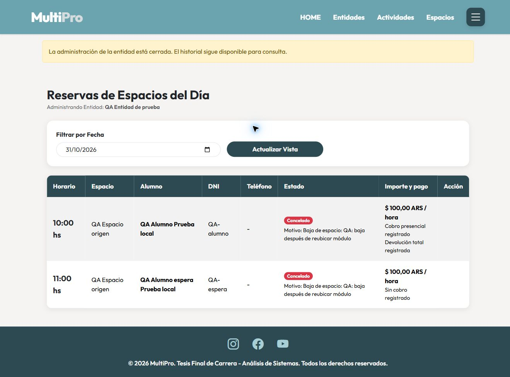

# MultiPro: validación local de filtros y cascadas

Fecha: 30/10/2026. Estado: pruebas automatizadas y recorrido funcional QA completados, con la salvedad de la confirmación nativa del navegador detallada al final. Sin publicación productiva.

## Entorno disponible

- Web: http://127.0.0.1:8080/ — acceso solo local.
- PostgreSQL Docker local: 127.0.0.1:5433, base activa `multipro_staging_filtros_cascada`.
- Es una restauración separada de `multipro_staging_local`. La base original se conservó sin migraciones ni cambios de datos en este bloque.
- Migraciones nuevas 008 (ubicación) y 009 (cascadas, auditoría y cierre) aplicadas a la copia en una transacción, junto con permisos del rol local.
- Correo deshabilitado en configuración local y en el proceso web. No se envía dinero ni se conecta Mercado Pago.
- Tres entidades ficticias para revisar los filtros: `DEMO · La Plata`, `DEMO · Mar del Plata`, `DEMO · Córdoba`. Tienen actividades y espacios gratuitos. Las cuentas anteriores de staging se conservan; no se generaron contraseñas públicas nuevas.

El proceso web iniciado usa `staging-local/php.ini`, raíz `web` y el puerto anterior. Su identificador se conserva en `staging-local/php-filtros-cascada.pid`; verificar que siga ejecutándose si se retoma otro día. No usar el preparador para reiniciar la web: el preparador se detiene cuando la copia ya existe.

## Resultado de las comprobaciones

| Área | Resultado observado |
|---|---|
| Filtros aislados | 81 consultas extraídas de los listados reales, selección simple/múltiple, combinación entre niveles, entradas inválidas, inactivas, homónimos, URL y escape de nombres. Aprobado. |
| PostgreSQL, pantallas y API de las funciones nuevas | 117 comprobaciones aprobadas. Incluyen ubicación administrada desde web, vista previa sin mutación, confirmación, protección de formulario, GET antiguo sin mutación, permisos y consulta posterior al cierre. |
| Espacio y reubicación | Baja bloqueada con módulo activo sin cambios parciales; reubicación permite baja; el módulo conserva actividad en destino. Aprobado. |
| Actividad, módulo e inscripciones | Suspensión, preservación de cupo/espera y canceladas, reapertura explícita, conflictos de cupo/edad/agenda e historial de asistencia. Aprobado. |
| Reservas y devoluciones | Futuras gratuitas y presenciales canceladas; cobrada genera solicitud total cuando la cancelación del usuario ocurre con 5 h o más, y siempre ante cancelación administrativa; no cobrada no genera devolución; entrega real posterior con entidad inactiva; sin duplicados al repetir. Aprobado. |
| Cierre y administrador | Pendientes de cobro antiguo y devolución bloquean; cancelada sin cobro no crea deuda; solo esos pendientes bloquean cierre y último administrador; consulta tras cerrar. Aprobado. |
| Concurrencia real | Procesos PHP separados: cobro contra baja, reserva contra baja y dos bajas simultáneas de administradores. Sin reserva activa que escape ni devolución perdida; se conserva un responsable. Aprobado. |
| Regresión existente | Web/API gratuitas y presenciales, configuración de precios, cobro concurrente, movimientos, cancelaciones, devolución, outbox/reintentos y recordatorios. Aprobado. Los proveedores online son dobles internos de prueba y no certifican Mercado Pago. |
| Migraciones y recuperación | Aplicación, rollback vacío y reaplicación 008/009; rollback rechazado cuando hay historia. Aprobado. |
| Visual | Chrome con aplicación real y PostgreSQL: filtro provincia, localidad y entidad, navegación entre Home/Actividades/Espacios y vista estrecha de 390 px. Contenido de 375 px sobre área de 375 px: sin desborde horizontal. Aprobado. |

La comprobación automatizada usa bases temporales `multipro_test_pagos_<fecha>` y usuarios efímeros. Al terminar elimina únicamente esa base creada por el propio comprobador. No usa usuarios productivos para ejecutar operaciones ni envía correos reales. Los casos de carreras prueban los invariantes de esas operaciones concretas; no son una prueba de carga masiva.

Ejecutar desde la raíz del repositorio, con Docker local disponible:

```powershell
pwsh -NoProfile -File tests/pagos/validar_local.ps1
```

El filtro aislado puede comprobarse sin PostgreSQL:

```powershell
$phpBinary = (Get-Command php).Source
$phpExt = Join-Path (Split-Path -Parent $phpBinary) 'ext'
& $phpBinary -d "extension_dir=$phpExt" -d extension=pdo_sqlite tests/filtros/validar.php
```

## Recorrido de aceptación del usuario

Realizar exclusivamente en la copia local y sobre datos identificados de prueba:

1. Abrir Actividades y elegir Buenos Aires: quedan las entidades DEMO de La Plata y Mar del Plata. Aplicar La Plata: queda una. Agregar una entidad y pasar a Espacios y Home: se conservan los tres niveles. Limpiar para volver al conjunto completo.
2. Como Gestor, editar una entidad de prueba y cargar provincia y localidad juntas. Comprobar que aparecen como opciones. Las entidades históricas sin ubicación no aparecen en filtros geográficos hasta que se complete su ubicación; siguen visibles sin filtro o seleccionándolas directamente.
3. Asignar un administrador a una entidad DEMO para probar su circuito. Crear/configurar módulo y espacio con cuentas de prueba, e inscribir alumnos y lista de espera. No distribuir nuevas claves en documentos o capturas.
4. Desactivar la actividad con motivo: revisar impacto y confirmar. Ver módulo inactivo e inscripciones suspendidas. Reactivar actividad: módulo sigue inactivo. Reactivar módulo y luego sus inscripciones en conjunto: conservar cupos y espera.
5. Intentar desactivar un espacio con módulo activo: debe bloquearse. Reubicar ese módulo en otro espacio activo y repetir: la baja puede confirmarse; las reservas futuras del espacio se cancelan.
6. Para devolución, configurar un espacio de prueba con precio y pago presencial, reservar y registrar el cobro. Desactivar espacio o entidad: revisar la solicitud de devolución pendiente. Registrar la entrega efectiva desde Reservas sin reabrir la oferta pública.
7. Intentar cerrar administración con cobros o devoluciones pendientes y dar de baja al último administrador: deben bloquearse. Resolver los pendientes reales de prueba y cerrar. Comprobar que permanece el historial y ya no se permiten nuevas gestiones administrativas.
8. Confirmar la aceptación o registrar los hallazgos. Después se preparará el plan de migración productiva; esta entrega no habilita esa migración.

## Respaldo y límites

Respaldo privado: `C:\MultiPro-Migration\MultiPro-Pagos-MVP\staging-local\private\antes-filtros-cascada-20261030-175628`. Incluye dump y configuración anterior. El dump fue restaurado realmente en la nueva base y se compararon huellas de diez tablas antes y después de migrar. La base original permaneció igual. Los datos DEMO se agregaron después de verificar la conservación de los registros anteriores.

El retorno de configuración puede volver al servidor/base local anterior conservado. Si la copia ya contiene cancelaciones, entregas de dinero o nuevas obligaciones de prueba, conservar esa historia; no confundir cambiar de conexión con deshacer los hechos. Los rollback 008/009 se niegan a eliminar datos o auditoría cuando existen.

La ubicación se administra con datos estructurados y nombres reutilizables; no hay geocodificación ni importación de un padrón oficial. Se normalizan espacios y mayúsculas, pero alias y errores de escritura requieren revisión del Gestor. Las opciones dependientes se actualizan al aplicar, sin requerir JavaScript.

Las operaciones de reservas y estados se serializan transaccionalmente para asegurar consistencia. No se realizó prueba de carga. No se alteró la APK ni se ejecutó una nueva prueba en teléfono físico: la revisión móvil corresponde a la web responsive; la API del profesor conserva su contrato y oculta oferta no disponible.

Productivo, Railway, credenciales productivas y Cron productivo quedaron fuera de este bloque. No se hizo commit, push, merge ni publicación de APK. Mercado Pago continúa bloqueado.

## Evidencia visual




## Precarga Georef aplicada en Local/Staging (30/10/2026, corte vigente)

El usuario autorizó retomar con «adelante con la precarga». Este corte reemplaza el estado pendiente anterior. La importación optimizada por lotes fue validada en base temporal: `GEOREF_OFICIAL_OK provincias=24 localidades=4028 comprobaciones=4053`, incluyendo integridad/UTF-8, preservación de IDs y vínculos, reimportación sin duplicados, rechazo de archivos alterados y selección/formulario HTTP real del Gestor.

Se aplicó migración 010 y catálogo a `multipro_staging_filtros_cascada`, exclusivamente local. Comprobación SQL posterior: 24 jurisdicciones oficiales, 4.028 localidades oficiales, 3 localidades manuales conservadas, 3 entidades con sus vínculos conservados y cero localidades sin provincia. El importador no reasignó entidades ni inventó códigos para coincidencias ambiguas. Fuente y archivo de descarga: `database/catalogos/georef/README.md` y `manifest.json`.

Respaldo privado previo: `C:\MultiPro-Migration\MultiPro-Pagos-MVP\staging-local\private\antes-georef-20261030-185555`. Se restauró en una base temporal y se compararon huellas antes de importar. Huellas de entidades, reservas e inscripciones iguales después de la aplicación. La base temporal de comprobación se eliminó; base local original y Productivo conservados.

El formulario Gestor ofrece Provincia/CABA y localidad dependiente, con búsqueda por nombre/departamento y una excepción manual explícita si falta una ubicación. La aplicación usa la copia local, sin llamadas externas por formulario. Los filtros públicos continúan mostrando únicamente ubicaciones de entidades activas disponibles, no todas las localidades del país sin oferta. Los tres desplegables de Filtros aprobados por el usuario se conservan.

Comprobaciones posteriores: 81 consultas aisladas de filtros aprobadas; sintaxis de CatalogoGeoref, ABM Entidades y JS de ubicaciones correcta; Home, Actividades y Espacios respondieron HTTP 200 sin error de listado. Sin commit/push, cambios productivos, modificaciones de Cron ni publicación de APK. Correo local sigue deshabilitado. Próximo paso: aceptación manual del Gestor en la copia local y revisión de cascadas; preparar plan productivo después de esa aceptación.


## Recorrido funcional QA completado (corte vigente 30/10/2026)

Se ejecutó la verificación delegada por el usuario en `multipro_qa_pantallas_20261030190259`, servidor local `http://127.0.0.1:8087/`. Se copió solo el esquema vigente y se cargaron catálogo oficial y datos ficticios. No se copiaron datos personales ni movimientos de las bases anteriores. Las sesiones PHP están separadas por nombre y carpeta para no interferir con la web de Staging en 8080. Correo deshabilitado; ningún movimiento de dinero real. Esta es una validación del mismo agente que implementó, no una auditoría independiente.

| Circuito | Canal y resultado observado |
|---|---|
| Ubicación oficial | Interfaz Gestor: seleccionó Buenos Aires y La Plata, guardó y volvió a abrir la entidad. Correcto. |
| Filtros | Interfaz pública: provincia/localidad/entidad seleccionadas, un resultado correcto para la entidad QA. Correcto. |
| Suspensión | Interfaz Admin: baja de actividad con vista previa, un módulo desactivado y dos inscripciones suspendidas. Alumno vio SUSPENDIDA. Correcto. |
| Dependencias | Interfaz Admin: intentar activar el módulo con actividad inactiva se rechazó con mensaje específico. Reabrir actividad dejó módulo inactivo. Correcto. |
| Recuperación conjunta | Interfaz Admin y Alumno/Profesor: reactivación explícita del módulo y de sus dos inscripciones; un alumno volvió a ACTIVA y el otro permaneció en espera, con cero vacantes. Correcto. |
| Baja bloqueada de espacio | Interfaz: módulo activo impidió la baja; las dos reservas permanecieron pendientes, sin cancelaciones parciales. Correcto. |
| Reubicación | Interfaz de edición del módulo: guardó destino nuevo. Vista previa de baja del origen indicó cero módulos activos vinculados, dos reservas y una devolución de $100. Correcto. |
| Cancelaciones y obligación | Interfaz: baja del origen canceló las dos reservas; la cobrada dejó devolución total pendiente, la no cobrada no creó movimientos. Módulo siguió activo en destino hasta la baja posterior de la entidad. Correcto. |
| Separación de cierre | Interfaz Gestor: entidad públicamente inactiva, devolución pendiente; cierre administrativo rechazado. Correcto. |
| Último administrador | Interfaz Gestor: baja rechazada mientras había devolución pendiente, conservando responsable activo. Se mejoró el mensaje para explicar el motivo. Correcto. |
| Entrega simulada | Formulario HTTP real autenticado como Admin, con CSRF: token inválido rechazado; solicitud válida registró una devolución ficticia con entidad inactiva. Estado final revisado en pantalla. Correcto, con límite de confirmación nativa indicado abajo. |
| Cierre final | Interfaz Gestor: vista previa con cero pendientes y cierre administrativo confirmado. Correcto. |
| Historia y permisos después de cerrar | Interfaz Admin: banner de administración cerrada y dos reservas históricas accesibles; devolución total registrada. HTTP: intento de escritura rechazado con 403 por regla de cierre. Correcto. |

**Límite de esta verificación:** no se pudo automatizar de forma fiable el `confirm()` nativo del navegador de cobros/devoluciones. El control de Windows se detuvo al no poder determinar con seguridad la página activa; no se modificó ni eliminó ese aviso del producto. Antes de retomar se consultó la base y se comprobó un único cobro existente. La devolución ficticia se terminó mediante el mismo formulario HTTP, con autenticación y CSRF, y se comprobó después desde la interfaz. No presentar este resultado como prueba automatizada de la interacción con el aviso nativo.

Verificación final de la base QA:

- Reserva 1: `cancelado`, exactamente un `cobro`, una `devolucion_solicitada` y una `devolucion`.
- Reserva 2: `cancelado`, sin movimientos económicos.
- Entidad: inactiva, cierre administrativo registrado y cero pendientes económicos.
- Módulo: inactivo por baja de entidad, vinculado al espacio destino 2.
- Inscripciones 1 y 2: suspendidas tras la baja de entidad; conservan respectivamente cupo y espera.
- Correos con estado enviada: cero.

Correcciones realizadas durante el recorrido: mensaje específico al bloquear la baja del último administrador, manteniendo el cerrojo y la protección de base de datos; y etiqueta Reactivar en actividad/espacio/administrador, reservando Reactivar / cerrar para entidad. No hubo cambios de esquema adicionales.

Regresión final tras esas correcciones aprobada: `CASCADA_Y_UBICACION_PG_OK casos=117`, `GEOREF_OFICIAL_OK ... comprobaciones=4053`, `PRUEBAS_NOTIFICACIONES_LOCAL_OK` y `PRUEBAS_SERVICIO_LOCAL_OK`; también reservas gratuitas/presenciales, API y concurrencia de la batería existente. Log privado: `staging-local/private/qa-pantallas-20261030190259/regresion-final.log`. El comprobador eliminó únicamente su base temporal. La base QA de recorrido se conserva para inspección; no sustituye la copia de Staging habitual.

Evidencias: `documentacion/evidencias/qa-pantallas/01-ubicacion-oficial.png` a `11-historial-tras-cierre.png`. Configuración y credenciales ficticias solo en la carpeta privada de QA, fuera de Git; no incluirlas en documentos ni capturas. La aplicación habitual sigue usando `multipro_staging_filtros_cascada` en 8080, con correo deshabilitado. Productivo, Railway, Cron y APK sin cambios; sin commit/push/merge.



El siguiente bloque es preparar y revisar el plan de migración productiva, sin ejecutar publicación ni cambios productivos en esta etapa. Este informe no autoriza un push a main ni sustituye la autorización separada de publicación.

## Cierre de condiciones previas a PRD (06/11/2026)

Se ejecutó nuevamente la batería integral sobre una base temporal creada desde `multipro_base_20261026` y eliminada al finalizar. La copia habitual de Staging y Producción no fueron modificadas.

Resultados comprobados:

- regla de devolución del usuario cambiada de 24 a 5 horas en pagos online preparados, pagos presenciales, validación de base y textos de Web/Mobile;
- cancelación a menos de 5 horas libera el turno sin devolución; con 5 horas o más solicita devolución; la cancelación administrativa conserva devolución total cuando existe cobro;
- el recordatorio de turno permanece correctamente a 24 horas y no se mezcló con la política económica;
- contraseña de 7 caracteres rechazada y contraseña de 8 aceptada por la API; Web, administradores, profesores y Android usan el mismo mínimo;
- migración `011` aplicada, revertida sin historia y reaplicada; una vez registrada auditoría, su rollback se rechaza para no perderla;
- asistencia futura rechazada por la API y por PostgreSQL; actualización de una asistencia histórica conserva profesor, creación y última modificación;
- permisos productivos de `provincias`, `localidades`, `operaciones_estado`, secuencias y funciones verificados mediante `FEATURECHECK MULTIPRO OK`;
- ejecutor Georef productivo protegido ensayado dos veces sobre la misma base temporal: 24 provincias, 4.028 localidades, sin duplicados y sin alterar conteos de entidades, reservas o inscripciones;
- regresión final: `CASCADA_Y_UBICACION_PG_OK casos=121`, `GEOREF_OFICIAL_OK ... comprobaciones=4053`, `PRUEBAS_NOTIFICACIONES_LOCAL_OK` y `PRUEBAS_SERVICIO_LOCAL_OK`;
- APK debug compilada correctamente.

Durante la primera ejecución se detectó que las marcas temporales predeterminadas de filas históricas podían diferir por microsegundos y el control interpretaba esa diferencia como auditoría nueva. Se corrigió para usar `registrado_por` como evidencia funcional de historia. Las dos ejecuciones integrales posteriores finalizaron correctamente.

Validación externa completada: el usuario instaló la APK debug y confirmó el 06/11/2026 que el calendario de Asistencia no permite seleccionar fechas posteriores al día actual. Esta confirmación cierra la validación física del cambio, pero no equivale a una publicación de release.
